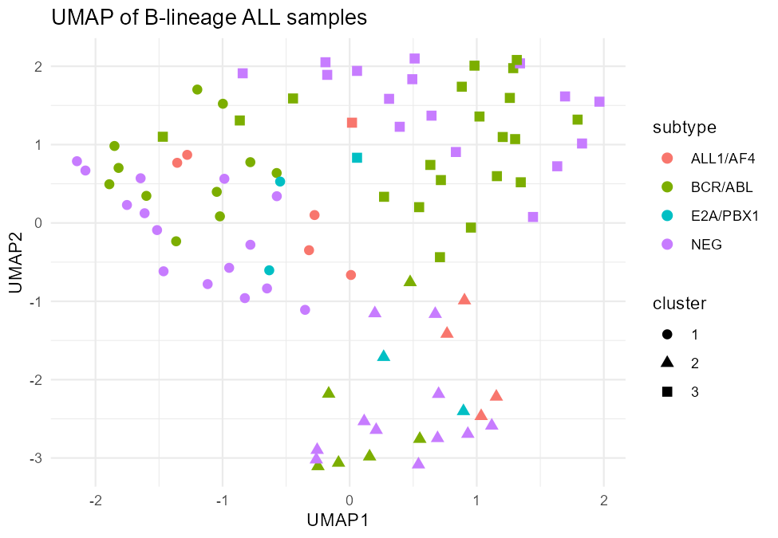
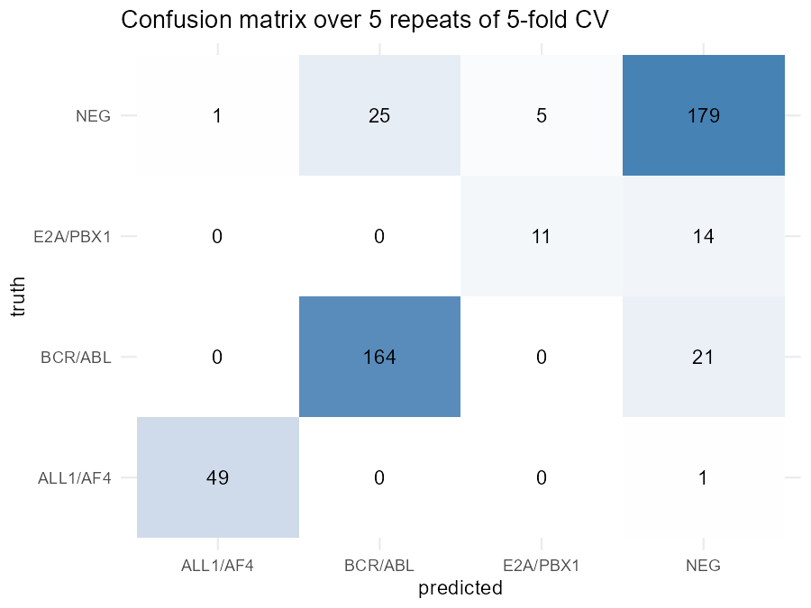

# Molecular subtype classification of B-lineage acute lymphoblastic leukaemia

A small, reproducible learning project in R: unsupervised subtype discovery and supervised classification from public gene-expression data.

## Data

The Bioconductor [`ALL`](https://bioconductor.org/packages/ALL/) data package: pre-processed Affymetrix HG-U95Av2 microarray profiles from adult ALL patients (Chiaretti et al., *Blood*, 2004). The analysis uses B-lineage samples from molecular groups with at least 5 samples.

## Workflow

1. **Quality control** of per-sample expression distributions.
2. **Feature selection** of the 1,000 most variable probe sets (median absolute deviation).
3. **Unsupervised analysis**: PCA, UMAP and k-means with consensus-based stability (PAC), silhouette, and adjusted Rand index against known subtypes.
4. **Classification**: elastic-net multinomial regression, assessed with repeated stratified 5-fold cross-validation. Gene selection and scaling are fitted only on each training fold to avoid data leakage. A shuffled-label run acts as a negative control.

## Reproduce

```bash
Rscript install_packages.R
Rscript run_all.R
```

Outputs are written to `results/`. Software versions are recorded in `results/sessionInfo.txt`.

## Results

<!-- Fill in after running: see the guide. -->
- Balanced accuracy: **TODO**
- Shuffled-label control: **TODO**
- Most stable number of clusters: **TODO**
- Main observation: **TODO**




## Limitations

This is a small, single-cohort microarray dataset with very small groups, so performance estimates are uncertain and have not been validated in an independent cohort. The "NEG" group is defined by the absence of tested abnormalities and is biologically heterogeneous. This is a learning project and is not intended for clinical use.
